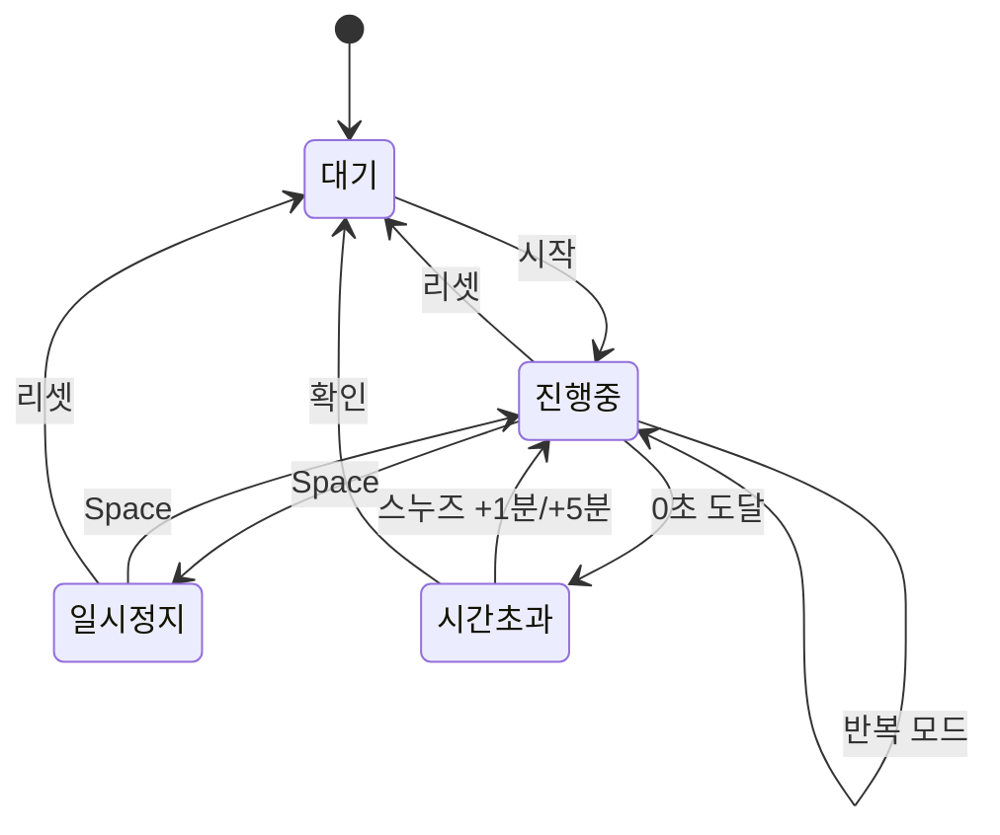

# ⏱️ OpsTimer 제작 과정

**파이썬으로 만든 Windows용 운영자급 타이머**
기획부터 바탕화면 아이콘까지

2026-10-31

![[timer-icon.png|160]]

---

## 1. 출발점: 무엇을 만들려 했나

> 파이썬으로 윈도우 PC용 타이머를 **운영자급**으로 만들어줘.

"운영자급"을 다음 기준으로 정의했습니다.

- **정확해야 한다:** 오래 켜 두어도 시간이 밀리지 않아야 함
- **놓치면 안 된다:** 끝났을 때 소리, 깜빡임, 팝업으로 확실히 알려야 함
- **현장에서 쓸 수 있어야 한다:** 단축키, 미니 창, 전체화면, 기록 저장
- **설치가 쉬워야 한다:** 추가 패키지 없이 실행되고, exe로 배포 가능

---

## 2. 기술 선택: 표준 라이브러리만 사용

| 모듈 | 역할 |
|---|---|
| `tkinter` | 화면(GUI) |
| `winsound` | 경보음 |
| `ctypes` | Windows API 호출 (절전 방지, 작업표시줄 깜빡임, 고해상도 화면 대응) |
| `threading` | 경보음을 화면과 분리해서 재생 |
| `csv`, `json` | 실행 기록과 설정 저장 |

> [!tip] 왜 표준 라이브러리만?
> `pip install` 없이 Python만 있으면 바로 실행됩니다. exe로 만들 때도 용량이 작고 오류 가능성이 줄어듭니다.

---

## 3. 완성된 화면

![[timer-screenshot.png|560]]

- 큰 숫자 표시 (창 크기에 맞춰 자동 확대)
- 진행 막대와 종료 예정 시각
- 프리셋 버튼 8개, ±1분/+5분 조정
- 소리 · 반복 · 항상 위 · 절전 방지 옵션

> [!note]
> 이 스크린샷은 개발 중 Linux 테스트 환경에서 찍은 것입니다. Windows에서는 Windows 기본 버튼 스타일로 표시됩니다.

---

## 4. 기능 한눈에 보기

| 구분 | 기능 |
|---|---|
| 타이머 | 자유 입력 (`5`, `90s`, `1h30m`, `25:00`, `1시간 30분`), 프리셋 원클릭 시작 |
| 알림 | 반복 경보음 + 작업표시줄 깜빡임 + 창 앞으로 + 알림창 (확인 / 스누즈 / 다시 시작) |
| 초과 시간 | 종료 후 `-00:12`처럼 초과 시간을 계속 표시 |
| 반복 모드 | 끝나면 자동 재시작 (뽀모도로, 정기 점검) |
| 스톱워치 | 1/100초 랩, 최고·최저 랩 색상 표시, CSV 저장 |
| 화면 모드 | 미니 플로팅 창, 전체화면 (발표·시험 감독용) |
| 기록 | 모든 실행 결과를 `%APPDATA%\OpsTimer\history.csv`에 저장 |
| 실행 옵션 | `Timer.exe 25m --mini` 처럼 바로 시작 |

---

## 5. 설계 ① 타이머의 상태

타이머는 항상 네 가지 상태 중 하나에 있습니다.



> [!tip] 상태를 먼저 정한 이유
> 버튼 하나(Space)가 상태에 따라 시작 · 일시정지 · 재개 · 확인으로 바뀝니다. 상태가 명확해야 이런 동작이 꼬이지 않습니다.

---

## 6. 설계 ② 시간이 밀리지 않는 계산

**흔한 방식 (문제 있음):** 1초마다 남은 시간에서 1을 뺀다
→ 프로그램이 잠깐 느려질 때마다 오차가 쌓임

**OpsTimer 방식:** 시작할 때 **종료 시각**을 정해 두고, 매번 남은 시간을 새로 계산

```python
# 시작할 때
self.t_deadline = now + self.t_total

# 화면을 갱신할 때마다 (0.05초 간격)
left = self.t_deadline - time.perf_counter()
```

> [!success] 결과
> 화면 갱신이 늦어져도 남은 시간은 항상 정확합니다. 반복 모드에서도 다음 종료 시각에 총 시간을 더하는 방식이라 주기가 밀리지 않습니다.

---

## 7. 설계 ③ Windows 기능 활용

`ctypes`로 Windows API를 직접 호출했습니다.

| 기능 | 사용한 API |
|---|---|
| 실행 중 절전·화면 꺼짐 방지 | `SetThreadExecutionState` |
| 작업표시줄 버튼 깜빡임 | `FlashWindowEx` |
| 고해상도 화면에서 선명하게 | `SetProcessDpiAwareness` |
| 작업표시줄 아이콘 분리 | `SetCurrentProcessExplicitAppUserModelID` |

> [!info] 경보음은 별도 스레드로
> `winsound.Beep`은 소리가 끝날 때까지 프로그램을 멈춥니다. 그래서 경보음을 별도 스레드에서 재생하고, 확인 버튼을 누르면 즉시 멈추도록 했습니다.

---

## 8. 개발 중 신경 쓴 디테일

- **Space 키 중복 실행 방지**
  버튼에 포커스가 있으면 Space가 버튼도 누르고 단축키도 실행해 두 번 동작합니다. 모든 버튼을 `takefocus=False`로 설정해 해결했습니다.
- **입력칸에서는 단축키 무시**
  시간을 입력하다 `r`이나 `-`를 누르면 리셋되지 않도록 했습니다.
- **필요할 때만 화면 갱신**
  글자가 바뀔 때만 다시 그려서 깜빡임과 CPU 사용을 줄였습니다.
- **창 제목에 남은 시간 표시**
  창을 내려놔도 작업표시줄에서 남은 시간을 볼 수 있습니다.
- **설정 안전 저장**
  임시 파일에 쓴 뒤 교체하는 방식이라, 저장 중 꺼져도 설정 파일이 깨지지 않습니다.

---

## 9. 검증: 실제로 돌려 보기

가상 화면에서 프로그램을 띄우고 2초 타이머로 전체 흐름을 자동 테스트했습니다.

| 단계 | 기대 상태 | 결과 |
|---|---|---|
| 시작 | 진행 중 | ✅ |
| Space | 일시정지 | ✅ |
| Space | 재개 | ✅ |
| 0초 도달 | 시간 초과 + 알림창 | ✅ |
| +1분 | 스누즈로 다시 진행 | ✅ |
| 리셋 | 대기 + "중단" 기록 | ✅ |
| 랩 3회 | 랩 3개 기록 | ✅ |
| 미니 모드 | 작은 창에 시간 표시 | ✅ |

> [!warning] 한계
> 자동 테스트 환경이 Linux여서 Windows 전용 기능(경보음, 작업표시줄 깜빡임, 절전 방지)은 Windows PC에서 직접 실행해 확인합니다.

---

## 10. 아이콘 만들기

Pillow로 스톱워치 모양을 직접 그려서 `.ico` 파일로 저장했습니다.

![[timer-icon.png|128]]

- 16 / 24 / 32 / 48 / 64 / 128 / 256px 7가지 크기를 한 파일에 담음
- 작업표시줄의 작은 크기(32px)에서도 알아보기 쉽게 단순한 형태로 디자인
- exe 파일 아이콘뿐 아니라 **타이머 창과 알림창 아이콘**에도 적용되도록 코드 보강

---

## 11. exe로 만들기 (PyInstaller)

```powershell
pip install pyinstaller
pyinstaller --clean --onefile --noconsole --name Timer --icon timer.ico --add-data "timer.ico;." timer.py
```

| 옵션 | 의미 |
|---|---|
| `--onefile` | 파일 하나짜리 exe로 생성 |
| `--noconsole` | 검은 콘솔 창 없이 실행 |
| `--icon timer.ico` | exe 파일 아이콘 지정 |
| `--add-data "timer.ico;."` | 아이콘을 exe 안에 포함해서 창 아이콘으로 사용 |
| `--clean` | 이전 빌드 임시 파일을 지우고 새로 빌드 |

결과물: `dist\Timer.exe` → Python이 없는 PC에서도 실행됩니다.

---

## 12. 트러블슈팅: 첫 빌드 실패

첫 빌드는 마지막 단계에서 멈췄습니다.

```text
FileNotFoundError: Icon input file ...\Timer\timer.ico not found
```

> [!bug] 원인
> `--icon timer.ico` 옵션을 넣었지만 폴더에 아이콘 파일이 없었습니다. 코드 문제가 아니라 파일 준비 문제였습니다.

> [!success] 해결
> 1. 아이콘 파일 `timer.ico`를 만들어 폴더에 넣음
> 2. 창 아이콘까지 적용되도록 코드 보강
> 3. `--add-data`, `--clean` 옵션을 추가해 다시 빌드 → 성공

**교훈:** 오류 메시지의 마지막 줄부터 읽으면 원인이 바로 보입니다.

---

## 13. 바탕화면에 아이콘 만들기

1. `dist` 폴더를 연다
2. `Timer.exe`를 우클릭
3. **추가 옵션 표시 → 보내기 → 바탕 화면(바로 가기 만들기)**

> [!tip] 더 편하게 쓰기
> - **키보드로 실행:** 바로 가기 속성 → 바로 가기 키에 `Ctrl+Alt+T` 지정
> - **시간별 아이콘:** 바로 가기 대상 뒤에 `25m`을 붙이면 클릭 즉시 25분 시작
> - **부팅 시 자동 실행:** `Win+R` → `shell:startup` 폴더에 바로 가기 복사

---

## 14. 최종 폴더 구성

```text
Timer\
├── timer.py          ← 소스 코드
├── timer.ico         ← 아이콘
├── Timer.spec        ← 빌드 설정 (자동 생성)
├── build\            ← 빌드 임시 파일 (삭제 가능)
└── dist\
    └── Timer.exe     ← ★ 실행 파일
```

> [!note]
> 이전 버전 파일(`Timer.pyw`, `Timer001.py`)과 예전 바로 가기는 정리해도 됩니다.

---

## 15. 전체 흐름 요약


---

## 16. 마무리

**배운 점**
- "잘 동작하는 타이머"의 핵심은 화면보다 **시간 계산 방식**
- 표준 라이브러리만으로도 Windows 기능을 깊게 활용할 수 있음
- 빌드 오류는 대부분 마지막 줄에 답이 있음

**다음에 해볼 것**
- 시스템 트레이 아이콘
- 여러 타이머 동시 실행
- 경보음을 원하는 소리 파일로 바꾸기

# 감사합니다 🙌
